# IQX8400 产品说明

适用硬件：IQX8400 Rev1.1。资料核对日期：2026 年 11 月 19 日。

IQX8400 是一款全高 PCIe 软件无线电板卡，采用 AMD Zynq UltraScale+ RFSoC XCZU47DR，提供四路发射和四路接收，用于宽带 I/Q 采集、波形回放和 FPGA 信号处理。配合主机可搭建多通道射频测试平台。板卡配置、安装条件和射频性能见下文。

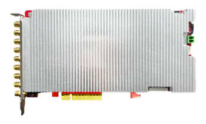

*图 1　IQX8400 覆装散热片的板卡实物。*

## 1 主要规格

| 项目 | 规格与条件 |
| --- | --- |
| 核心器件 | XCZU47DR RFSoC，Rev1.1 原理图为 FFVE1156、−2I。PS 集成四核 Arm Cortex-A53 和双核 Cortex-R5F。 |
| 射频通道 | 4 TX + 4 RX，工作频率可独立配置。对外使用 50 Ω SMA。 |
| 射频调谐范围 | TX、RX 均为 1 MHz～7.125 GHz，按 YunSDR 公布。带边处的增益、平坦度和失真按实际频点确认。 |
| 瞬时带宽 | 官网列示最高 1 GHz 或四通道各 250 MHz 模式。可用带宽取决于中心频率、采样与滤波配置。 |
| 复数 I/Q 速率 | 官网列示最高 1,000 MS/s，常用宽带配置还有 983.04、960 MS/s。官网列出的 PS 开机默认速率为 245.76 MS/s。 |
| 转换器 | 14 bit RF-ADC、14 bit RF-DAC。实际基础采样率取决于时钟拓扑与 RFDC 配置，见第 5 节。 |
| 存储 | PL DDR4 2 GiB，PS DDR4 4 GiB。板载 QSPI Flash 用于存放启动镜像。 |
| 主机接口 | PCIe 4.0 ×8。官网列示 8 GB/s，链路协商结果及持续吞吐按主机、固件、驱动和数据方向核验。 |
| 基准与触发 | 支持板载参考和外部 10 MHz 参考。提供时钟／PPS 级联、独立触发输入输出及板载 GPS。 |
| 基础板卡尺寸 | 高 111.15 mm × 长 208 mm，全高、单槽位。 |
| 基础板卡重量 | 约 0.48 kg，含原配置散热片。 |
| 单板功耗 | 50 W。 |
| 供电与温度 | PCIe 插槽供电或外接 12 V DC，工作温度 −20～65 °C。 |

1 MHz～7.125 GHz 是可调谐范围。AMD DS926 给出的 ZU4xDR ADC 与 DAC 满功率模拟 −3 dB 带宽典型值均为 6 GHz。Rev1.1 的巴伦标称范围为 10 MHz～8 GHz，接收 LNA 标称上限为 7 GHz。低端及 6 GHz 以上尤其应按图表的覆盖和实测结果评估。 [YunSDR 产品规格](https://www.yunsdr.com/resource-center/IQX8400/specification) · [AMD RF-ADC 电气特性](https://docs.amd.com/r/en-US/ds926-zynq-ultrascale-plus-rfsoc/RF-ADC-Electrical-Characteristics) · [AMD RF-DAC 电气特性](https://docs.amd.com/r/en-US/ds926-zynq-ultrascale-plus-rfsoc/RF-DAC-Electrical-Characteristics)

## 2 接口与面板

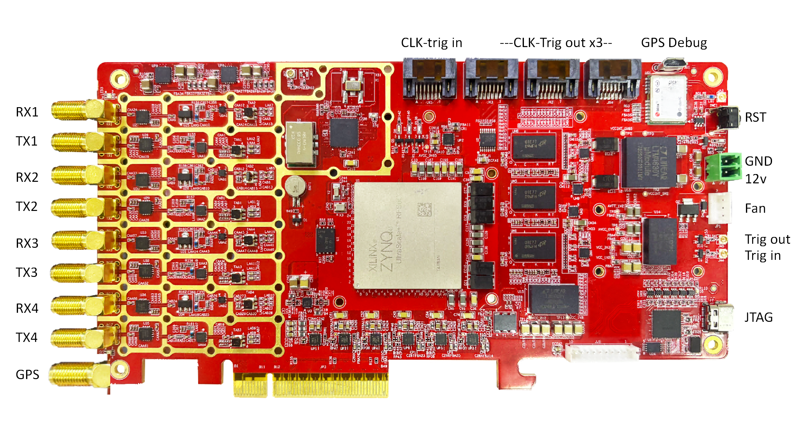

*图 2　IQX8400 Rev1.1 接口标注。底图为按该版本装配布局修订的板卡照片。板卡元件面朝上，射频口在左，PCIe 金手指在下缘。*

| 接口 | 位置与功能 |
| --- | --- |
| RX1～RX4、TX1～TX4 | 左侧由上至下依次为 RX1、TX1、RX2、TX2、RX3、TX3、RX4、TX4。各端口按固件的射频开关配置使用。 |
| GPS | 图 2 左下角标注为 GPS 天线端。Rev1.1 原理图中接收机为 NEO-M8N，板上天线节点为 JA3。 |
| CLK-trig in | 上缘最左侧 JX1，输入一组差分参考时钟和一组差分 PPS。 |
| CLK-trig out ×3 | 上缘其余三个，从左至右为 JX3、JX2、JX4。每个接口携带一路差分时钟和一路差分 PPS。接口使用 SATA 外形连接器，电气定义为同步信号。 |
| 板上参考 CLK IN / REF OUT | Rev1.1 的 JA1 / JA2，为板上 I-PEX 同轴节点。外部 10 MHz 输入电平按第 5 节核对，输出电平按配置确认。 |
| Trig out / Trig in | 图 2 右侧的小型同轴接口，对应 JA5 / JA4，用于独立硬件触发。3.3 V I/O 域，外部连线按实际转接线、地参考与电平定义核对。 |
| GND / 12 V | 右侧绿色端子为外接 12 V DC。按图 2 方向，上为 GND，下为 +12 V。接线前以实物丝印核对。 |
| Fan / RST | 右侧 FAN 插座用于配套散热，RST 用于板卡复位。 |
| JTAG / UART | 右下 USB Type-C，经 FT2232HQ 提供 USB 2.0 调试及串口功能。高速 I/Q 流通过 PCIe。 |
| GPS Debug | 右上 GPS 调试口，连接板载 GPS 模块，用于模块配置及状态查看。 |
| FPGA GPIO | 下缘 USER_IO 排针，8 根用户 I/O，3.3 V I/O 域。功能与方向由固件配置。 |
| PCIe ×8 | 下缘 PCIe 金手指接主机数据及控制链路。 |

## 3 主机安装

### 板卡尺寸 功耗与散热

IQX8400 为全高单槽 PCIe 板卡。基础板卡外形为 **208 mm（长）× 111.15 mm（高）**，含原配置散热片约 **0.48 kg**。单板功耗按 **50 W**，可由 PCIe 插槽或外接 12 V DC 供电。覆装散热片时，应保留射频接口、挡板、金手指及电源接线的操作空间，并通过机箱风道带走热量。

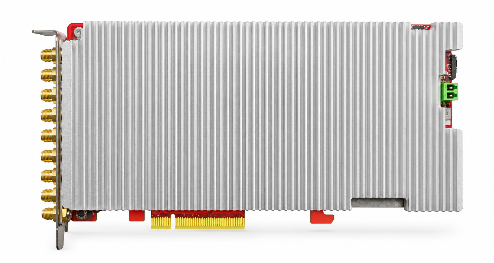

*图 3　IQX8400 覆装散热片示意。板卡外形尺寸见上文，散热片结构以实际装配为准。*

### 机箱装配

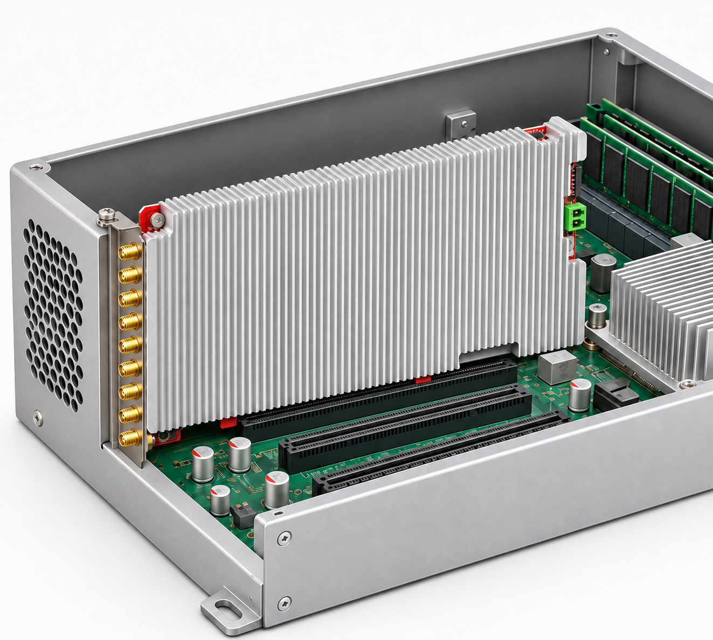

*图 4　IQX8400 装入机箱后的示意。板卡插入主板 PCIe 插槽，挡板固定于机箱后部。*

### 安装步骤

1. 关闭主机、断开供电并采取静电防护。选择可容纳 208 mm 全高板卡、提供至少 ×8 电气通道的 PCIe 插槽。检查加装散热壳与风扇后的相邻槽位、上盖净空及射频线缆弯曲空间。
2. 拆下对应挡板，将板卡对准导向和插槽，压入至金手指完全就位，锁紧机箱挡板及适用的尾部支撑。
3. 按主机和板卡配置选用供电方式，固定散热风扇并接好电源。按 50 W 单板功耗留出连续气流，确认线缆避开风扇和散热鳍片。
4. 按图 2 连接射频、参考和触发。收发回环时在 TX 与 RX 之间配置与频段和功率匹配的外部衰减，先用低 TX 电平和低 RX 增益核对电平，再逐步调整。
5. 启动后核对 PCIe 枚举、协商速率与宽度、驱动及固件版本、时钟锁定和板卡温度。先做单通道低电平收发，再检查多通道持续流和热稳态。

选配散热壳的厚度、重量、固定孔位和槽位占用以实际装配为准。基础随箱件见第 8 节。

## 4 系统原理

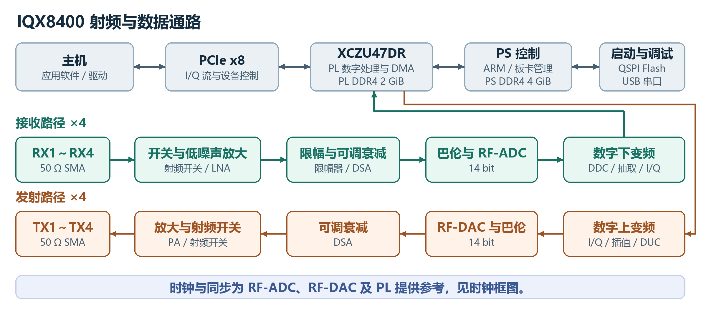

*图 5　依据 Rev1.1 绘制的功能框图。收发链路各四路，框图按独立 TX/RX 端口画出典型信号方向。*

- **接收。** 端口信号经射频开关、LNA、限幅器、DSA 和巴伦进入 RF-ADC。RFDC 及 PL 负责数字下变频、抽取和 I/Q 搬运，再经 PCIe 上传或在板侧处理。
- **发射。** 主机或板侧数字逻辑提供复数 I/Q，经插值、数字上变频及 RF-DAC 转为模拟信号，再经过巴伦、DSA、PA 和射频开关到达端口。TDD 共口与独立收发的实际路由由固件控制，经过的射频开关数量随路由而变。
- **控制与缓存。** 板载 QSPI Flash 存放启动镜像。PS 负责上电后的控制和状态管理。PL 负责确定性数据通路及主机数据搬运，并可使用 PL DDR4 作缓存。以每个复数样本 16 bit I + 16 bit Q 估算，1 路 × 1,000 MS/s 和 4 路 × 250 MS/s 均为每方向 4.0 GB/s 的纯载荷，双向时分别核算 H2C 与 C2H，并留出协议和主机处理裕量。

## 5 时钟 采样与同步

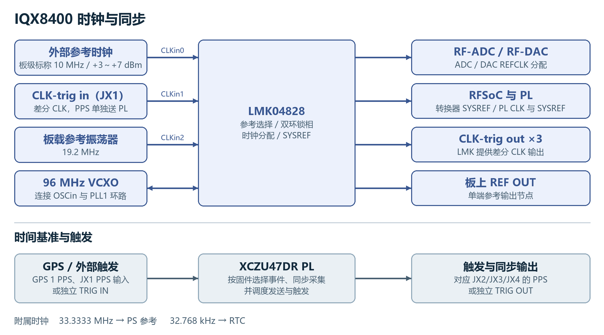

*图 6　依据 Rev1.1 时钟、系统时钟和 PIO 页绘制。JX1 的时钟进入 LMK04828，PPS 进入 PL。*

| 项目 | 硬件与使用条件 |
| --- | --- |
| 外部参考 | 官网规定 10 MHz、+3～+7 dBm，适用于外部参考输入口。JX1 是差分级联接口，信号电平按该接口定义配置。 |
| 板载参考 | 板载参考振荡器为 19.2 MHz，另有 96 MHz VCXO 用于锁相环。 |
| 时钟分配 | LMK04828 对参考时钟进行选择与锁相，向转换器提供 ADC/DAC REFCLK，向 RFSoC 与 PL 提供 SYSREF 和 PL 时钟，并提供参考、级联时钟输出。具体频率、格式和电平随固件配置。 |
| 多通道同步 | 同一参考源用于统一频率基准。RFDC 多 Tile 同步（MTS）、NCO 相位更新及定时触发需由固件配置。板卡间相位一致性还取决于时钟／PPS 布线、上电校准和射频通道校准。 |
| GPS 与触发 | GPS 的 1 PPS、JX1 输入 PPS 和独立 TRIG IN 可供固件选作时间或触发事件。GPS 锁定精度、参考输出精度、触发延迟及多板相位重复性待板级量化。 |

[TI LMK04828 数据手册](https://www.ti.com/lit/ds/symlink/lmk04828.pdf) · [AMD PG269 时钟输入](https://docs.amd.com/r/en-US/pg269-rf-data-converter/Clock-Inputs) · [AMD PG269 多转换器同步](https://docs.amd.com/r/en-US/pg269-rf-data-converter/Detailed-Description)

### 采样率配置

#### ADC 与 DAC 基础采样率

下表列出 YunSDR 官网的全部基础采样率组合。各档 DAC 基础速率为 ADC 的两倍。

| ADC 基础采样率（MS/s） | DAC 基础采样率（MS/s） |
| --- | ---: |
| 5000 | 10000 |
| 4915.2 | 9830.4 |
| 4800 | 9600 |
| 4500 | 9000 |
| 4423.68 | 8847.36 |
| 4320 | 8640 |
| 4000 | 8000 |
| 3932.16 | 7864.32 |
| 3200 | 6400 |
| 3000 | 6000 |
| 2880 | 5760 |
| 2700 | 5400 |

#### 复数 I/Q 采样率

下表数值单位为 MS/s。按 ADC 基础采样率与等效抽取倍数组合查表，“—”表示官网未列该组合。PS 开机默认 I/Q 采样率为 245.76 MS/s。

**ADC 基础采样率 4,320～5,000 MS/s**

| 等效抽取倍数 | 5000.00 | 4915.20 | 4800.00 | 4500 | 4423.68 | 4320.00 |
| --- | ---: | ---: | ---: | ---: | ---: | ---: |
| 3 | — | — | — | — | — | — |
| 4 | 1250.00 | 1228.80 | 1200.00 | 1125.00 | 1105.92 | 1080.00 |
| 5 | 1000.00 | 983.04 | 960.00 | 900.00 | 884.74 | 864.00 |
| 6 | 833.33 | 819.20 | 800.00 | 750.00 | 737.28 | 720.00 |
| 8 | 625.00 | 614.40 | 600.00 | 562.50 | 552.96 | 540.00 |
| 10 | 500.00 | 491.52 | 480.00 | 450.00 | 442.37 | 432.00 |
| 12 | 416.67 | 409.60 | 400.00 | 375.00 | 368.64 | 360.00 |
| 16 | 312.50 | 307.20 | 300.00 | 281.25 | 276.48 | 270.00 |
| 20 | 250.00 | 245.76 | 240.00 | 225.00 | 221.18 | 216.00 |
| 24 | 208.33 | 204.80 | 200.00 | 187.50 | 184.32 | 180.00 |
| 32 | 156.25 | 153.60 | 150.00 | 140.63 | 138.24 | 135.00 |
| 40 | 125.00 | 122.88 | 120.00 | 112.50 | 110.59 | 108.00 |
| 48 | 104.17 | 102.40 | 100.00 | 93.75 | 92.16 | 90.00 |
| 64 | 78.13 | 76.80 | 75.00 | 70.31 | 69.12 | 67.50 |
| 80 | 62.50 | 61.44 | 60.00 | 56.25 | 55.30 | 54.00 |
| 96 | 52.08 | 51.20 | 50.00 | 46.88 | 46.08 | 45.00 |
| 160 | 31.25 | 30.72 | 30.00 | 28.13 | 27.65 | 27.00 |
| 128 | 39.06 | 38.40 | 37.50 | 35.16 | 34.56 | 33.75 |
| 192 | 26.04 | 25.60 | 25.00 | 23.44 | 23.04 | 22.50 |
| 256 | 19.53 | 19.20 | 18.75 | 17.58 | 17.28 | 16.88 |
| 320 | 15.63 | 15.36 | 15.00 | 14.06 | 13.82 | 13.50 |
| 384 | 13.02 | 12.80 | 12.50 | 11.72 | 11.52 | 11.25 |
| 640 | 7.81 | 7.68 | 7.50 | 7.03 | 6.91 | 6.75 |

**ADC 基础采样率 2,700～4,000 MS/s**

| 等效抽取倍数 | 4000 | 3932.16 | 3200 | 3000 | 2880.00 | 2700 |
| --- | ---: | ---: | ---: | ---: | ---: | ---: |
| 3 | — | — | 1066.67 | 1000.00 | 960.00 | 900.00 |
| 4 | 1000.00 | 983.04 | 800.00 | 750.00 | 720.00 | 675.00 |
| 5 | 800.00 | 786.43 | 640.00 | 600.00 | 576.00 | 540.00 |
| 6 | 666.67 | 655.36 | 533.33 | 500.00 | 480.00 | 450.00 |
| 8 | 500.00 | 491.52 | 400.00 | 375.00 | 360.00 | 337.50 |
| 10 | 400.00 | 393.22 | 320.00 | 300.00 | 288.00 | 270.00 |
| 12 | 333.33 | 327.68 | 266.67 | 250.00 | 240.00 | 225.00 |
| 16 | 250.00 | 245.76 | 200.00 | 187.50 | 180.00 | 168.75 |
| 20 | 200.00 | 196.61 | 160.00 | 150.00 | 144.00 | 135.00 |
| 24 | 166.67 | 163.84 | 133.33 | 125.00 | 120.00 | 112.50 |
| 32 | 125.00 | 122.88 | 100.00 | 93.75 | 90.00 | 84.38 |
| 40 | 100.00 | 98.30 | 80.00 | 75.00 | 72.00 | 67.50 |
| 48 | 83.33 | 81.92 | 66.67 | 62.50 | 60.00 | 56.25 |
| 64 | 62.50 | 61.44 | 50.00 | 46.88 | 45.00 | 42.19 |
| 80 | 50.00 | 49.15 | 40.00 | 37.50 | 36.00 | 33.75 |
| 96 | 41.67 | 40.96 | 33.33 | 31.25 | 30.00 | 28.13 |
| 160 | 25.00 | 24.58 | 20.00 | 18.75 | 18.00 | 16.88 |
| 128 | 31.25 | 30.72 | 25.00 | 23.44 | 22.50 | 21.09 |
| 192 | 20.83 | 20.48 | 16.67 | 15.63 | 15.00 | 14.06 |
| 256 | 15.63 | 15.36 | 12.50 | 11.72 | 11.25 | 10.55 |
| 320 | 12.50 | 12.29 | 10.00 | 9.38 | 9.00 | 8.44 |
| 384 | 10.42 | 10.24 | 8.33 | 7.81 | 7.50 | 7.03 |
| 640 | 6.25 | 6.14 | 5.00 | 4.69 | 4.50 | 4.22 |

产品规格页标称 I/Q 速率最高 1,000 MS/s。表中高于该标称值的组合也按官网原表列出，可用档位随固件和采样配置变化。相同 I/Q 速率下，按表中 ADC、DAC 基础速率配置 RX 总抽取及 TX 总插值。 [YunSDR 产品规格](https://www.yunsdr.com/resource-center/IQX8400/specification)

XCZU47DR 双通道 RF-ADC Tile 最高基础采样率为 5.0 GS/s。AMD DS926 对 −2I 级 RF-DAC 在指定数据通路下列出 9.85 GS/s（无时钟转发）及 9.70 GS/s（有时钟转发）。官网表列 10.0 GS/s，实际可用的高速档位以所用时钟拓扑、器件支持范围和固件为准。 [AMD DS926 RF-DAC 电气特性](https://docs.amd.com/r/en-US/ds926-zynq-ultrascale-plus-rfsoc/RF-DAC-Electrical-Characteristics)

## 6 厂商公布的射频性能

功率和线性度读数以官网可见曲线为依据，取代表频点并作近似读图。官网图中列出的条件随对应曲线使用。新增板级数据应记录 50 Ω 连接器参考面、固件和时钟配置、端口、温度、增益、波形与测量带宽。

### 发射功率与衰减

| 项目 | 公布值或读图值 |
| --- | --- |
| 可设发射衰减 | 0～76 dB，软件设定步进 0.1 dB，上电默认最大衰减。控制路径包括外置 DSA、数字幅度和 DAC 电流。 |
| 外置 DSA 本体 | 外置 DSA 在 0.5 dB 步进模式下提供 0～31.5 dB。实际端口电平精度和全幅调节范围依频率与校准而定。 |
| TX 输出 P1dB | 500 MHz 约 +10.5 dBm，1 GHz 约 +10.7 dBm，2 GHz 约 +9.7 dBm，4 GHz 约 +9.7 dBm，6 GHz 约 +5.0 dBm。 |

P1dB 表示单音压缩点。调制波形的最大可用输出按规定 EVM、邻道泄漏和峰均比在相应频点确定。 [YunSDR 产品规格](https://www.yunsdr.com/resource-center/IQX8400/specification)

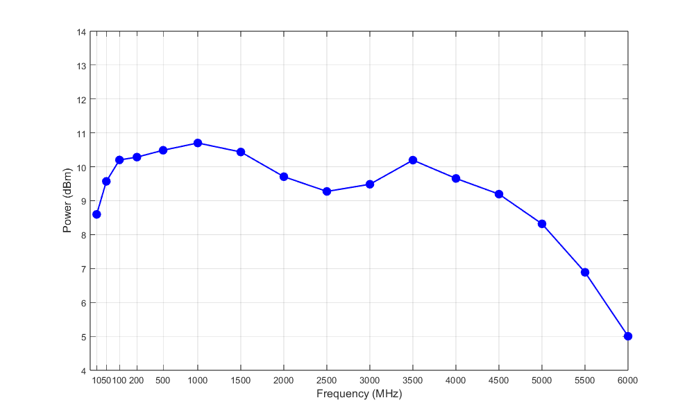

*图 7　TX 输出 P1dB。*

### 接收功率与增益

官网列示可设 RX 增益为 0～58 dB，步进 1 dB，开机默认最小增益。该设置分段控制 RFSoC 内部 DSA 和板载 DSA，表示相对增益档位。下表按官网 RX Gain = 27 dB 图读数。

| 频率 | RX 输入 P1dB（dBm） | 最小可检测信号（dBm） |
| --- | ---: | ---: |
| 500 MHz | 约 −21 | 约 −99 |
| 1 GHz | 约 −19 | 约 −101 |
| 2 GHz | 约 −17 | 约 −89 |
| 3.5 GHz | 约 −13 | 约 −99 |
| 5 GHz | 约 −9 | 约 −89 |
| 5.8 GHz | 约 −3 | 约 −88 |

公开曲线未给出最小可检测信号的等效噪声带宽与判据，其数值按原图条件引用。RX 输入损伤电平、ADC 达到 0 dBFS 的板端输入功率和输入 P1dB 应分别记录。 [YunSDR 产品规格](https://www.yunsdr.com/resource-center/IQX8400/specification)

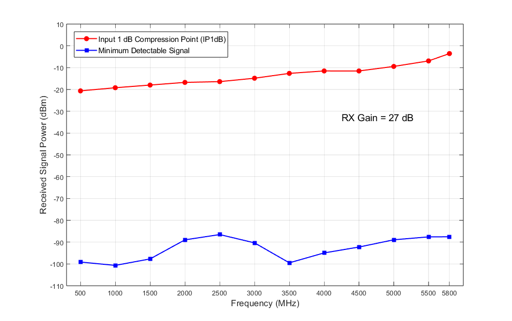

*图 8　RX 输入压缩点与最小可检测信号。*

### 相位噪声与发射 EVM

| 载频 | 100 Hz 偏移 | 1 kHz 偏移 | 10 kHz 偏移 | 100 kHz 偏移 | 1 MHz 偏移 |
| --- | ---: | ---: | ---: | ---: | ---: |
| 1 GHz | −90 | −111 | −115 | −117 | −128 |
| 2.5 GHz | −83 | −104 | −110 | −113 | −120 |
| 4 GHz | −78 | −97 | −108 | −111 | −117 |
| 6 GHz | −74 | −92 | −105 | −108 | −114 |

相位噪声单位为 dBc/Hz，均为官网系统相噪曲线约读值。参考源、PLL 配置、采样率和温度将影响结果。 [YunSDR 产品规格](https://www.yunsdr.com/resource-center/IQX8400/specification)

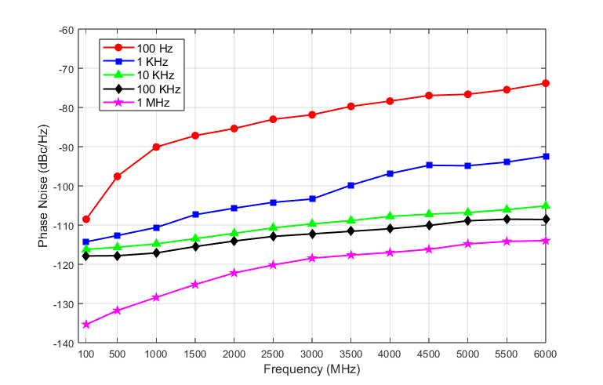

*图 9　系统相位噪声，图例为相对载频的偏移频率。*

官网 **100 MHz 发射 EVM** 图在 500 MHz、1 GHz、3 GHz、6 GHz、7.1 GHz 载频的读图值分别约为 **0.53%、0.56%、0.94%、1.33%、1.41%**。官网未在图中注明调制方式、输出功率或统计口径。建立产品验收条件时需补充波形、参考功率及均衡设置。 [YunSDR 产品规格](https://www.yunsdr.com/resource-center/IQX8400/specification)

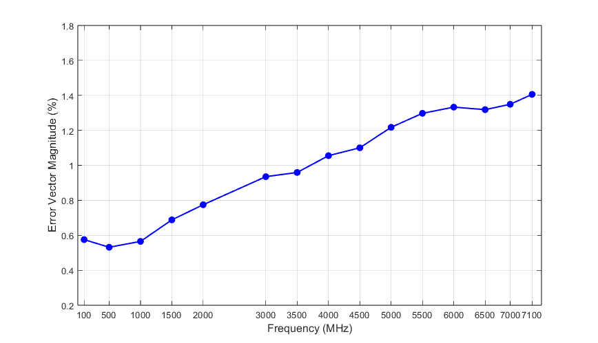

*图 10　100 MHz 发射 EVM。*

## 7 射频链路估算与补测项目

### 接收噪声系数预算

以下为 Rev1.1 射频连接器至数字 I/Q 的等效小信号 NF 估算。采用 LNA 在 25 °C 的典型增益与 NF，放大器前损耗假定为 1 dB，放大器后至 ADC 假定为 3 dB（含限幅器、零档 DSA、巴伦及走线）。内外 DSA 的附加衰减均设为 0 dB。AMD 手册典型小信号 ADC 噪声底 −154 dBFS/Hz 和满量程约 +1 dBm，对应约 −153 dBm/Hz 的 ADC 输入折算噪声，按 290 K 热噪声 −174 dBm/Hz 折合约 21 dB 的 ADC 等效 NF。

| 频率（GHz） | LNA 增益（dB） | LNA NF（dB） | 板端等效 NF 估算（dB） |
| ---: | ---: | ---: | ---: |
| 0.5 | 22.86 | 2.34 | 5.8 |
| 2.0 | 19.89 | 2.32 | 7.3 |
| 3.0 | 18.16 | 2.43 | 8.5 |
| 4.0 | 16.91 | 2.70 | 9.4 |
| 6.0 | 16.19 | 2.87 | 10.0 |

将增益、噪声因子和损耗换算成线性量后，按下式计算。F系统 = L前 × [F放大器 + (L后 × FADC − 1) / G放大器]。将结果转为 dB 后可估算输入噪声。举例来说，在 2 GHz、约 7.3 dB NF 和 1 MHz 等效噪声带宽下，输入折算噪声约 −106.7 dBm。特定波形的接收灵敏度还需加上解调所需 SNR 及实现裕量。 [AMD DS926 RF-ADC 性能表 9](https://docs.amd.com/r/en-US/ds926-zynq-ultrascale-plus-rfsoc/RF-ADC-Performance-Characteristics)

### 发射噪声密度预算

预算采用 AMD 手册 20 mA 低噪声模式、外部采样时钟、0 dBFS 连续单音的离散点。DSA 在零档只计典型插损（1.6～2.0 dB），巴伦和前级互连另计 1 dB，末级到连接器计 0.8 dB。按 PA 在 9 V 供电时的典型增益和 NF 折算，将 DAC、无源损耗和放大器噪声在线性域求和。

| 频率（GHz） | DAC 噪声密度（dBm/Hz） | 连接器噪声密度估算（dBm/Hz） |
| ---: | ---: | ---: |
| 0.24 | −164.4 | −149.9 |
| 1.9 | −160.4 | −146.7 |
| 2.4 | −159.9 | −146.4 |
| 3.5 | −158.8 | −145.2 |
| 4.9 | −157.3 | −144.0 |
| 5.9 | −157.0 | −143.8 |

这些离散点用于估计零附加衰减、小信号线性链路的噪声量级。实测需记录工作电平、载波偏移、分辨率带宽归一化及是否剔除离散杂散。 [AMD DS926 RF-DAC 性能表 6](https://docs.amd.com/r/en-US/ds926-zynq-ultrascale-plus-rfsoc/RF-DAC-Performance-Characteristics)

### 线性度 隔离与同步

除另列载频外，链路预算以 **2 GHz、50 Ω、内外 DSA 零附加衰减**为基准。结果注明对应的参考面和模型范围。

| 项目 | 结果 | 测试方法 |
| --- | --- | --- |
| NCO 调谐分辨率 | ADC 约 **18 µHz**、DAC 约 **35 µHz**（48 bit NCO 理论步进，采样率分别为 5.00、9.85 GS/s） | 逐步改变设定频率，比较设定值与实测载波频率。 |
| TX/RX 热切换时间 | **225 ns**（1 GHz 时射频开关的典型稳定时间，至最终插损 ±0.1 dB） | 同步捕获触发沿、射频包络和 RX I/Q，测量 TX→RX 与 RX→TX 的恢复时间。 |
| TX/RX 外置衰减稳定时间 | **0.5 µs**（DSA 锁存后典型值，至最终电平 ±0.05 dB）。**约 2.1 µs**（16 bit 以 10 MHz 写入并稳定的计算值） | 改变衰减档位，用示波器测量从串行写入或锁存至射频电平稳定的时间。 |
| 转换器 SFDR | DAC **73.6 dBc**（2.4 GHz，20 mA 低噪声模式，内部 PLL，0 dBFS），ADC **82 dBc**（3.5 GHz，零 DSA）。均为器件典型值，按器件手册排除指定谐波或杂散。 | 输入或生成单音，采集频谱并读出最大杂散，分别标出谐波、镜像及交织杂散。 |
| ADC 二音互调 IM3 | **−75 dBc**（器件典型值，中心频率 2.4 GHz，双音各 −7 dBFS、间隔 20 MHz，零 DSA） | 注入双音，从频谱读取基波与三阶互调分量之差。 |
| TX OIP3、RX IIP3 | TX **+34.7 dBm**（发射模拟末级折算至 TX 端口）。RX **+6.1 dBm**（开关、放大器及 ADC 级联折算至 RX 端口）。 | 用双音法测量端口的三阶互调并外推 IP3。 |
| TX ACLR | **78.4 dB**（2.4 GHz、3.84 MHz QPSK、峰均比 7.6 dB，20 mA 低噪声 DAC 使用外部采样时钟的典型值，按线性传输折算）。以 TX 主信道 0 dBm、邻信道 3.84 MHz 积分估计，连接器噪声对应的 ACLR 为 **80.6 dB**。 | 发射调制信号，积分主信道和相邻信道功率。 |
| RX 满幅输入与过载 | **−14.9 dBm**（2 GHz 小信号线性外推至数字满幅，接近压缩区时会偏离）。**约 +14 dBm**（由 LNA 绝对最大输入额定折算的前级过载上界）。整板允许输入及损伤阈值须由整板过载验证确定。 | 从低电平扫至数字满幅。整板损伤阈值使用专用样机开展过载试验。 |
| RX EVM | **约 0.15% RMS**（输入 −30 dBm、100 MHz 等效噪声带宽、NF 7.3 dB 的噪声贡献估算） | 注入已知调制波形，扫描输入电平并测量 RMS EVM。 |
| 通带幅度平坦度 | 在 **1.8～2.2 GHz** 的简化链路模型中，TX 约 **0.10 dB 峰峰值**、RX 约 **0.84 dB 峰峰值**。 | 扫频采集归一化幅度响应，取通带最大值与最小值之差。 |
| 通带相位平坦度、群时延 | 简化链路的标称传播时延约 **0.298 ns**。去除线性相位后，阻抗反射引入的相位波纹估算为 TX **±0.13°**、RX **±0.23°**；对应的群时延偏差约为 TX **±1.3 ps**、RX **±2.4 ps**。 | 扫频采集复数响应，以相位斜率求群时延，去除拟合线性相位后读取残差。 |
| 端口回波损耗 | 2 GHz 两反射面同相叠加时，TX 约 **19.8 dB**、RX 约 **17.9 dB**（两器件匹配模型）。 | 将矢网校准面设在射频连接器处，测量端口反射系数。 |
| TX–TX、RX–RX、TX–RX 隔离 | 2 GHz 假定 PCB 耦合路径为 65 dB，按同相叠加预算。TX–TX、RX–RX 各约 **62.6 dB**，TX–RX（TDD 共口开关漏通模型）约 **59.9 dB**。 | 将激励端和受扰端依次接到仪表，给激励端送单音，测量受扰端泄漏功率。 |
| 通道电平及相位一致性、重复性 | 外置 DSA 设置为 10 dB 时，两路衰减误差相差最多 **2.45 dB**（仅 DSA 贡献）。相对走线长度差 1 mm 对应 **4.3°** 相差。复位后残余时序差若为 5 ps，对应 **3.6°** 相位差。 | 使用同源激励比较各通道幅相差，在改频或重启后重复测量。 |

**计算口径**

- **IP3、满幅输入与过载。** TX 取 PA 的典型 OIP3 35.47 dBm，扣除末级后约 0.8 dB 损耗。RX 取 LNA 的增益 19.89 dB、典型 OIP3 25.50 dBm，放大器前后损耗分别取 1 dB、3 dB，ADC 用 1.9 GHz 的 −75 dBc 双音数据近似。各级输入截点统一折算至 RX 连接器后作倒数叠加。RX 小信号净增益为 15.89 dB，按 ADC 满幅约 +1 dBm 折算得到 −14.9 dBm。LNA 的绝对最大输入为 +13 dBm，加上前级约 1 dB 损耗得到前级过载上界。
- **ACLR 与 EVM。** TX 邻道噪声取上一节 2.4 GHz 的 −146.4 dBm/Hz，积分 3.84 MHz 得 −80.6 dBm，另列 DAC 典型 ACLR。RX 以 −174 dBm/Hz 热噪声密度、NF 7.3 dB、100 MHz 带宽算得 −86.7 dBm 输入等效噪声，−30 dBm 输入对应 SNR 56.7 dB。表中 EVM 仅计该噪声贡献。 [AMD DS926 RF-DAC 性能](https://docs.amd.com/r/en-US/ds926-zynq-ultrascale-plus-rfsoc/RF-DAC-Performance-Characteristics) · [AMD DS926 RF-ADC 性能](https://docs.amd.com/r/en-US/ds926-zynq-ultrascale-plus-rfsoc/RF-ADC-Performance-Characteristics)
- **幅相与阻抗。** 计算采用 50 mm 等效走线、有效介电常数 3.2、放大器典型频响和两个反射面。两面的回波损耗取射频开关的 23 dB、PA 输出的 30.06 dB 或 LNA 输入的 25.06 dB。通带幅度预算将两端反射引入的最大波纹与放大器 1.8～2.2 GHz 增益变化相加。端口回波损耗以两反射波同相求和，群时延以走线传播加往返反射造成的相位斜率变化估算。转换器、巴伦、板上其他过渡和数字滤波的幅相影响由整板扫频覆盖。
- **隔离与一致性。** 同类通道按 DS926 的 ZU4xDR 家族 75 dB 串扰参考值建模，该项表征基于 XCZU46DR-H1760。TDD 共口估算采用射频开关在 2 GHz 的 67 dB RFC 到关闭支路隔离。两种情况均叠加假设的 65 dB PCB 耦合路径。外置 DSA 在 10 dB 档的衰减误差范围为 −1.00～+1.45 dB。相位差按 2 GHz、360° × 载频 × 时延差折算。 [AMD DS926 RF-ADC 电气特性](https://docs.amd.com/r/en-US/ds926-zynq-ultrascale-plus-rfsoc/RF-ADC-Electrical-Characteristics) · [AMD DS926 RF-DAC 电气特性](https://docs.amd.com/r/en-US/ds926-zynq-ultrascale-plus-rfsoc/RF-DAC-Electrical-Characteristics)

## 8 产品配套清单

| 序号 | 品名 | 规格或型号 | 数量 |
| ---: | --- | --- | ---: |
| 1 | 软件无线电模组 | IQX8400 | 1 片 |
| 2 | 5G 全向测试天线 | ANT-1427-5925MHZ | 8 个 |
| 3 | SMA 直通电缆 | SMA–SMA | 4 条 |
| 4 | PCIe 散热风扇 | PCIE-FAN | 1 个 |

随箱件以订单配置为准。配套天线按其适用频段使用。主机、GPS 天线、额外衰减器及项目专用散热壳按项目配置选配。 [YunSDR 官方配套清单](https://www.yunsdr.com/resource-center/IQX8400/specification)

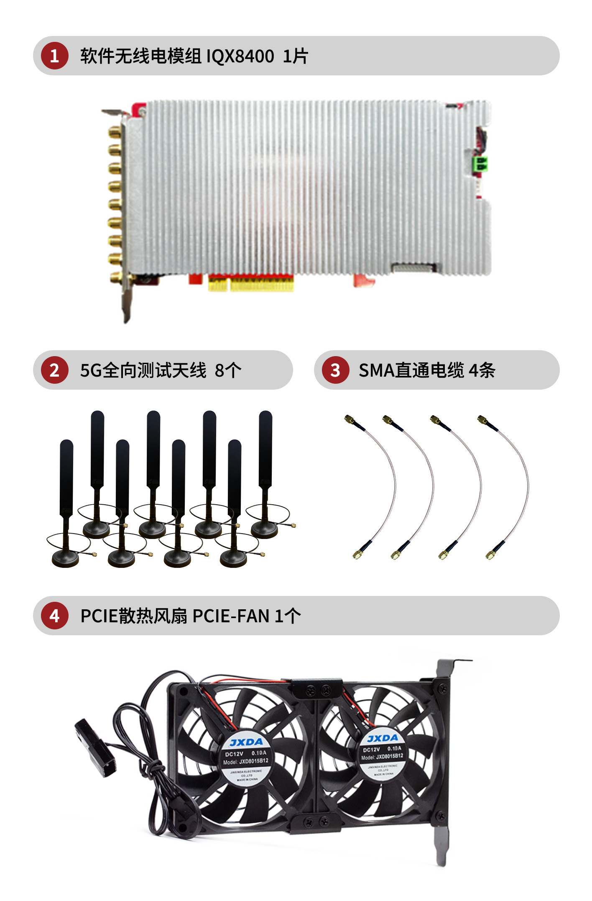

*图 11　IQX8400 配套件实物组合，板卡为覆装散热片状态。*
