# IQX8400 Product Description

Applies to IQX8400 Rev1.1. Specifications reviewed on November 19, 2026.

The IQX8400 is a full-height PCIe software-defined radio (SDR) board based on the AMD Zynq UltraScale+ RFSoC XCZU47DR. It provides four transmit channels and four receive channels for wideband I/Q capture, waveform playback, and FPGA-based signal processing. The board connects to a host computer to form a multichannel RF test platform.

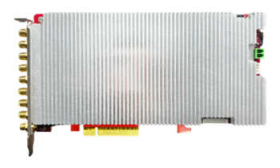

*Figure 1. IQX8400 board fitted with a heatsink.*

## 1 Key Specifications

| Parameter | Specification and conditions |
| --- | --- |
| RFSoC | XCZU47DR in the FFVE1156 package, speed grade −2I, as specified in the Rev1.1 schematic. The processing system (PS) integrates a quad-core Arm Cortex-A53 and a dual-core Cortex-R5F. |
| RF channels | Four transmit (TX) and four receive (RX) channels. Each channel can be tuned independently. External connections use 50 Ω SMA connectors. |
| RF tuning range | 1 MHz to 7.125 GHz for both TX and RX, as published by YunSDR. Characterize gain, flatness, and distortion at the frequencies of interest near the band edges. |
| Instantaneous bandwidth | YunSDR lists a maximum of 1 GHz or a four-channel mode with 250 MHz per channel. Usable bandwidth depends on the center frequency, sample rate, and filter settings. |
| Complex I/Q sample rate | The published maximum is 1,000 MS/s. Common wideband configurations also include 983.04 and 960 MS/s. The published default at PS startup is 245.76 MS/s. |
| Data converters | 14-bit RF-ADC and 14-bit RF-DAC. The converter sample rates depend on the clocking topology and RF Data Converter (RFDC) configuration. See Section 5. |
| Memory and boot storage | 2 GiB of DDR4 for the programmable logic (PL) and 4 GiB of DDR4 for the PS. Onboard QSPI flash stores the boot image. |
| Host interface | PCIe 4.0 ×8. YunSDR lists 8 GB/s. Verify the negotiated link and sustained throughput for the host, firmware, driver, and transfer direction in use. |
| Reference and triggering | Onboard reference and external 10 MHz reference input, clock and PPS daisy-chaining, dedicated trigger input and output, and onboard GPS. |
| Board dimensions | 111.15 mm high by 208 mm long, full-height and single-slot. |
| Board weight | Approximately 0.48 kg with the standard heatsink. |
| Board power consumption | 50 W. |
| Power supply and operating temperature | PCIe slot power or an external 12 V DC supply. Operating temperature range of −20 °C to 65 °C. |

The RF tuning range is 1 MHz to 7.125 GHz. AMD DS926 specifies a typical full-power −3 dB analog bandwidth of 6 GHz for the ZU4xDR RF-ADC and RF-DAC. The Rev1.1 balun is rated from 10 MHz to 8 GHz, and the RX low-noise amplifier (LNA) has a nominal upper frequency limit of 7 GHz. Use the plotted frequency coverage and measurements at the target frequency, especially at the lower band edge and above 6 GHz. [YunSDR product specifications](https://www.yunsdr.com/resource-center/IQX8400/specification) · [AMD RF-ADC electrical characteristics](https://docs.amd.com/r/en-US/ds926-zynq-ultrascale-plus-rfsoc/RF-ADC-Electrical-Characteristics) · [AMD RF-DAC electrical characteristics](https://docs.amd.com/r/en-US/ds926-zynq-ultrascale-plus-rfsoc/RF-DAC-Electrical-Characteristics)

## 2 Board Interfaces and Connectors

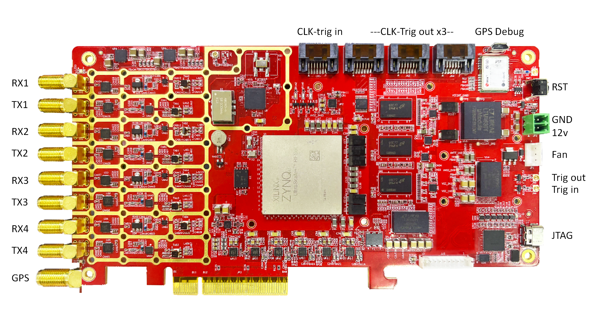

*Figure 2. IQX8400 Rev1.1 connector locations. The board photograph has been retouched to reflect the Rev1.1 assembly layout. The component side faces up, the RF ports are on the left, and the PCIe edge connector is along the bottom.*

| Interface | Location and function |
| --- | --- |
| RX1–RX4 and TX1–TX4 | From top to bottom on the left edge, the ports are RX1, TX1, RX2, TX2, RX3, TX3, RX4, and TX4. The firmware controls their RF switch routing. |
| GPS | The bottom-left connector in Figure 2 is the GPS antenna port. The Rev1.1 schematic identifies the NEO-M8N receiver and the JA3 antenna connection on the board. |
| CLK-trig in | JX1, the leftmost connector on the top edge, accepts a differential reference clock and a differential pulse-per-second (PPS) signal. |
| CLK-trig out ×3 | The remaining top-edge connectors are JX3, JX2, and JX4 from left to right. Each carries a differential clock and a differential PPS signal. They use SATA-style connectors with a timing-signal pinout. |
| Onboard CLK IN / REF OUT | JA1 and JA2 are I-PEX coaxial connections on Rev1.1. See Section 5 for the external 10 MHz reference input level. The output level depends on the configuration. |
| Trig out / Trig in | The small coaxial ports on the right in Figure 2 are JA5 and JA4, respectively. They provide dedicated hardware triggering in a 3.3 V I/O domain. Match the adapter, ground reference, and signal levels to the connected equipment. |
| GND / 12 V | The green terminal block on the right accepts external 12 V DC. In the orientation shown in Figure 2, GND is above +12 V. Check the board silkscreen before wiring. |
| Fan / RST | The fan header on the right connects to the cooling fan. RST resets the board. |
| JTAG / UART | The lower-right USB Type-C port provides USB 2.0 debug and serial access through the FT2232HQ. High-speed I/Q streaming uses PCIe. |
| GPS Debug | The upper-right connector provides configuration and status access to the onboard GPS module. |
| FPGA GPIO | The USER_IO header on the bottom edge provides eight user I/O signals in a 3.3 V domain. Firmware sets their function and direction. |
| PCIe ×8 | The bottom-edge PCIe connector carries host data and control traffic. |

## 3 Host Installation

### Board Dimensions, Power, and Cooling

The IQX8400 is a full-height, single-slot PCIe board. It measures **208 mm long by 111.15 mm high** and weighs approximately **0.48 kg** with the standard heatsink. Allow **50 W** per board. Power can come from the PCIe slot or from an external 12 V DC supply. A full-coverage heatsink installation needs clearance around the RF connectors, mounting bracket, PCIe edge connector, and power wiring, as well as airflow through the chassis.

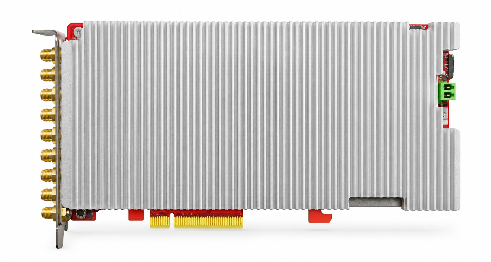

*Figure 3. Full-coverage heatsink illustration. The final heatsink geometry depends on the assembly.*

### Chassis Installation

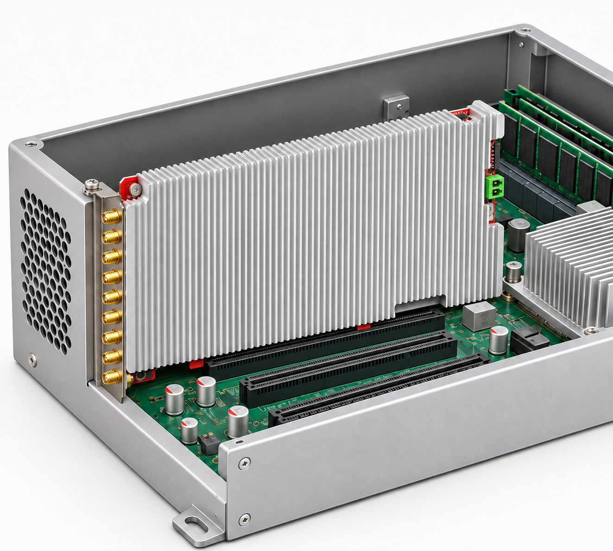

*Figure 4. IQX8400 installed in a chassis. The board seats in the motherboard PCIe slot, and its bracket fastens to the rear of the chassis.*

### Installation Procedure

1. Shut down the host, disconnect power, and take electrostatic discharge (ESD) precautions. Use a PCIe slot with at least eight electrically connected lanes and clearance for a 208 mm full-height card. Check adjacent slots, lid clearance, and RF cable bend radius with the heatsink and fan in place.
2. Remove the corresponding slot cover. Align the board with the guide and PCIe slot, press until the edge connector is fully seated, and fasten the bracket and any applicable rear support.
3. Select the power source that matches the host and board configuration. Mount the cooling fan and connect its power. Maintain continuous airflow for a 50 W board and route cables clear of the fan and heatsink fins.
4. Connect the RF, reference, and trigger signals as shown in Figure 2. For TX-to-RX loopback, use external attenuation rated for the frequency and power involved. Start with a low TX level and low RX gain, verify the received level, and increase it gradually.
5. After startup, check PCIe enumeration, negotiated link speed and width, driver and firmware versions, clock lock, and board temperature. Start with low-level, single-channel operation. Then verify sustained multichannel streaming and steady-state temperature.

The installed heatsink option determines thickness, weight, mounting-hole locations, and slot occupancy. See Section 8 for standard package contents.

## 4 System Architecture

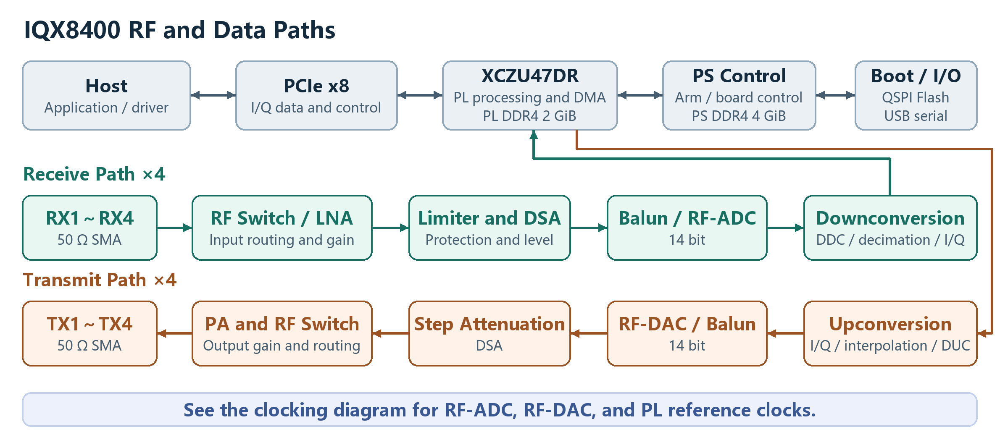

*Figure 5. IQX8400 Rev1.1 functional block diagram. The arrows show the typical signal flow for four dedicated TX ports and four dedicated RX ports.*

- **Receive path.** The input passes through an RF switch, LNA, limiter, digital step attenuator (DSA), and balun before reaching the RF-ADC. The RFDC and PL perform digital downconversion, decimation, and I/Q data movement. The samples can stream to the host over PCIe or undergo further processing on the board.
- **Transmit path.** Complex I/Q from the host or onboard logic passes through interpolation and digital upconversion before conversion to analog RF by the RF-DAC. The signal then passes through a balun, DSA, power amplifier (PA), and RF switch to the output. Firmware selects shared-port operation for time-division duplexing (TDD) or dedicated TX/RX routing. The number of RF switches in the signal path depends on the selected route.
- **Control and buffering.** Onboard QSPI flash holds the boot image. The PS handles control and status management after startup. The PL implements the deterministic data path and transfers data to and from the host, with optional buffering in PL DDR4. With 16 bits each for I and Q, both one channel at 1,000 MS/s and four channels at 250 MS/s carry 4.0 GB/s of payload in each active direction. Budget host-to-card (H2C) and card-to-host (C2H) throughput separately for bidirectional streaming and allow for protocol and host-processing overhead.

## 5 Clocking, Sample Rates, and Synchronization

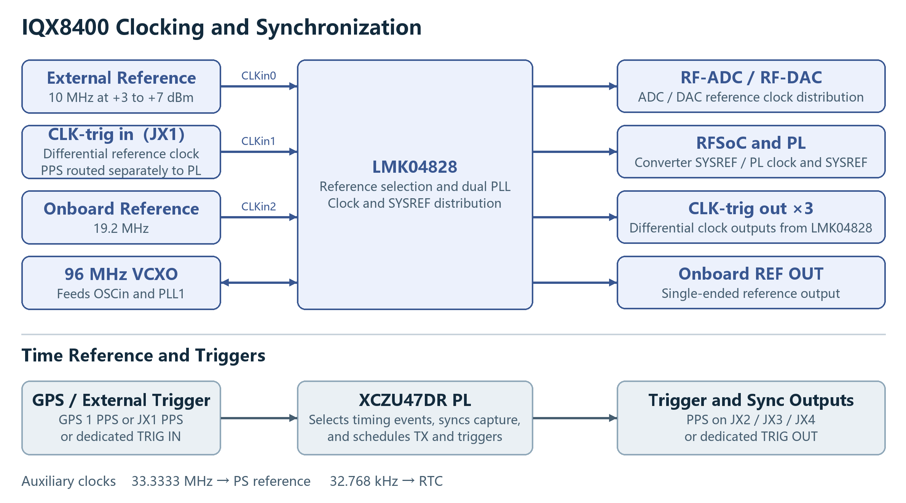

*Figure 6. Rev1.1 clocking and synchronization. The JX1 clock signal goes to the LMK04828, and the JX1 PPS signal goes to the PL.*

| Parameter | Hardware and operating conditions |
| --- | --- |
| External reference | YunSDR specifies 10 MHz at +3 to +7 dBm for the external reference input. Set the signal levels at the differential JX1 daisy-chain input to match that interface. |
| Onboard reference | The onboard reference oscillator runs at 19.2 MHz. A 96 MHz voltage-controlled crystal oscillator (VCXO) serves the phase-locked loop (PLL). |
| Clock distribution | The LMK04828 selects and locks to the reference, distributes ADC and DAC reference clocks, supplies SYSREF and the PL clock, and drives the reference and daisy-chain clock outputs. Firmware sets the frequencies, formats, and levels. |
| Multichannel synchronization | A shared reference provides a common frequency basis. Firmware configures RFDC multi-tile synchronization (MTS), numerically controlled oscillator (NCO) phase updates, and timed triggers. Board-to-board phase alignment also depends on clock and PPS cabling, startup calibration, and RF channel calibration. |
| GPS and triggering | Firmware can select GPS 1 PPS, JX1 PPS, or dedicated TRIG IN as a timing or trigger event. Board-level characterization is pending for GPS timing accuracy when locked, reference output accuracy, trigger latency, and board-to-board phase repeatability. |

[TI LMK04828 datasheet](https://www.ti.com/lit/ds/symlink/lmk04828.pdf) · [AMD PG269 clock inputs](https://docs.amd.com/r/en-US/pg269-rf-data-converter/Clock-Inputs) · [AMD PG269 multi-tile synchronization](https://docs.amd.com/r/en-US/pg269-rf-data-converter/Detailed-Description)

### Sample Rate Configuration

#### ADC and DAC Converter Sample Rates

The table lists all converter sample-rate pairs published by YunSDR. The DAC sample rate is twice the ADC sample rate in each configuration.

| ADC converter sample rate (MS/s) | DAC converter sample rate (MS/s) |
| --- | ---: |
| 5000 | 10000 |
| 4915.2 | 9830.4 |
| 4800 | 9600 |
| 4500 | 9000 |
| 4423.68 | 8847.36 |
| 4320 | 8640 |
| 4000 | 8000 |
| 3932.16 | 7864.32 |
| 3200 | 6400 |
| 3000 | 6000 |
| 2880 | 5760 |
| 2700 | 5400 |

#### Complex I/Q Sample Rates

All rates in the table are in MS/s. Select the ADC converter sample rate and the effective decimation factor. A dash indicates an unlisted combination. The default I/Q sample rate at PS startup is 245.76 MS/s.

**ADC converter sample rates from 4,320 to 5,000 MS/s**

| Effective decimation factor | 5000.00 | 4915.20 | 4800.00 | 4500 | 4423.68 | 4320.00 |
| --- | ---: | ---: | ---: | ---: | ---: | ---: |
| 3 | — | — | — | — | — | — |
| 4 | 1250.00 | 1228.80 | 1200.00 | 1125.00 | 1105.92 | 1080.00 |
| 5 | 1000.00 | 983.04 | 960.00 | 900.00 | 884.74 | 864.00 |
| 6 | 833.33 | 819.20 | 800.00 | 750.00 | 737.28 | 720.00 |
| 8 | 625.00 | 614.40 | 600.00 | 562.50 | 552.96 | 540.00 |
| 10 | 500.00 | 491.52 | 480.00 | 450.00 | 442.37 | 432.00 |
| 12 | 416.67 | 409.60 | 400.00 | 375.00 | 368.64 | 360.00 |
| 16 | 312.50 | 307.20 | 300.00 | 281.25 | 276.48 | 270.00 |
| 20 | 250.00 | 245.76 | 240.00 | 225.00 | 221.18 | 216.00 |
| 24 | 208.33 | 204.80 | 200.00 | 187.50 | 184.32 | 180.00 |
| 32 | 156.25 | 153.60 | 150.00 | 140.63 | 138.24 | 135.00 |
| 40 | 125.00 | 122.88 | 120.00 | 112.50 | 110.59 | 108.00 |
| 48 | 104.17 | 102.40 | 100.00 | 93.75 | 92.16 | 90.00 |
| 64 | 78.13 | 76.80 | 75.00 | 70.31 | 69.12 | 67.50 |
| 80 | 62.50 | 61.44 | 60.00 | 56.25 | 55.30 | 54.00 |
| 96 | 52.08 | 51.20 | 50.00 | 46.88 | 46.08 | 45.00 |
| 160 | 31.25 | 30.72 | 30.00 | 28.13 | 27.65 | 27.00 |
| 128 | 39.06 | 38.40 | 37.50 | 35.16 | 34.56 | 33.75 |
| 192 | 26.04 | 25.60 | 25.00 | 23.44 | 23.04 | 22.50 |
| 256 | 19.53 | 19.20 | 18.75 | 17.58 | 17.28 | 16.88 |
| 320 | 15.63 | 15.36 | 15.00 | 14.06 | 13.82 | 13.50 |
| 384 | 13.02 | 12.80 | 12.50 | 11.72 | 11.52 | 11.25 |
| 640 | 7.81 | 7.68 | 7.50 | 7.03 | 6.91 | 6.75 |

**ADC converter sample rates from 2,700 to 4,000 MS/s**

| Effective decimation factor | 4000 | 3932.16 | 3200 | 3000 | 2880.00 | 2700 |
| --- | ---: | ---: | ---: | ---: | ---: | ---: |
| 3 | — | — | 1066.67 | 1000.00 | 960.00 | 900.00 |
| 4 | 1000.00 | 983.04 | 800.00 | 750.00 | 720.00 | 675.00 |
| 5 | 800.00 | 786.43 | 640.00 | 600.00 | 576.00 | 540.00 |
| 6 | 666.67 | 655.36 | 533.33 | 500.00 | 480.00 | 450.00 |
| 8 | 500.00 | 491.52 | 400.00 | 375.00 | 360.00 | 337.50 |
| 10 | 400.00 | 393.22 | 320.00 | 300.00 | 288.00 | 270.00 |
| 12 | 333.33 | 327.68 | 266.67 | 250.00 | 240.00 | 225.00 |
| 16 | 250.00 | 245.76 | 200.00 | 187.50 | 180.00 | 168.75 |
| 20 | 200.00 | 196.61 | 160.00 | 150.00 | 144.00 | 135.00 |
| 24 | 166.67 | 163.84 | 133.33 | 125.00 | 120.00 | 112.50 |
| 32 | 125.00 | 122.88 | 100.00 | 93.75 | 90.00 | 84.38 |
| 40 | 100.00 | 98.30 | 80.00 | 75.00 | 72.00 | 67.50 |
| 48 | 83.33 | 81.92 | 66.67 | 62.50 | 60.00 | 56.25 |
| 64 | 62.50 | 61.44 | 50.00 | 46.88 | 45.00 | 42.19 |
| 80 | 50.00 | 49.15 | 40.00 | 37.50 | 36.00 | 33.75 |
| 96 | 41.67 | 40.96 | 33.33 | 31.25 | 30.00 | 28.13 |
| 160 | 25.00 | 24.58 | 20.00 | 18.75 | 18.00 | 16.88 |
| 128 | 31.25 | 30.72 | 25.00 | 23.44 | 22.50 | 21.09 |
| 192 | 20.83 | 20.48 | 16.67 | 15.63 | 15.00 | 14.06 |
| 256 | 15.63 | 15.36 | 12.50 | 11.72 | 11.25 | 10.55 |
| 320 | 12.50 | 12.29 | 10.00 | 9.38 | 9.00 | 8.44 |
| 384 | 10.42 | 10.24 | 8.33 | 7.81 | 7.50 | 7.03 |
| 640 | 6.25 | 6.14 | 5.00 | 4.69 | 4.50 | 4.22 |

The product page lists a nominal maximum I/Q sample rate of 1,000 MS/s. The tables also reproduce higher-rate combinations from the published sample-rate matrix. Available settings depend on the firmware and sampling configuration. For a given I/Q rate, use the ADC and DAC converter sample rates to determine the overall RX decimation factor and TX interpolation factor. [YunSDR product specifications](https://www.yunsdr.com/resource-center/IQX8400/specification)

The XCZU47DR dual-channel RF-ADC tile supports converter sample rates up to 5.0 GS/s. For the −2I RF-DAC and the specified datapath modes, AMD DS926 lists up to 9.85 GS/s without clock forwarding and 9.70 GS/s with clock forwarding. The YunSDR table includes 10.0 GS/s. Actual high-rate settings depend on the clocking topology, device limits, and firmware. [AMD DS926 RF-DAC electrical characteristics](https://docs.amd.com/r/en-US/ds926-zynq-ultrascale-plus-rfsoc/RF-DAC-Electrical-Characteristics)

## 6 Published RF Performance

Power and linearity values at representative frequencies are approximate readings from YunSDR's published plots. Apply the conditions stated on each plot. For board-level measurements, record the 50 Ω connector reference plane, firmware and clock configuration, port, temperature, gain settings, waveform, and measurement bandwidth.

### Transmit Power and Attenuation

| Parameter | Published or approximate value |
| --- | --- |
| Programmable TX attenuation | 0 to 76 dB, with software settings in 0.1 dB increments. The board starts at maximum attenuation. The control combines external DSA settings, digital amplitude scaling, and DAC output current. |
| External DSA range | 0 to 31.5 dB in 0.5 dB step mode. Actual port-level accuracy and usable adjustment range depend on frequency and calibration. |
| TX output P1dB | Approximately +10.5 dBm at 500 MHz, +10.7 dBm at 1 GHz, +9.7 dBm at 2 GHz, +9.7 dBm at 4 GHz, and +5.0 dBm at 6 GHz. |

P1dB is the single-tone 1 dB compression point. For a modulated waveform, determine the maximum usable output at the target frequency using the specified error vector magnitude (EVM), adjacent-channel leakage, and peak-to-average power ratio (PAPR). [YunSDR product specifications](https://www.yunsdr.com/resource-center/IQX8400/specification)

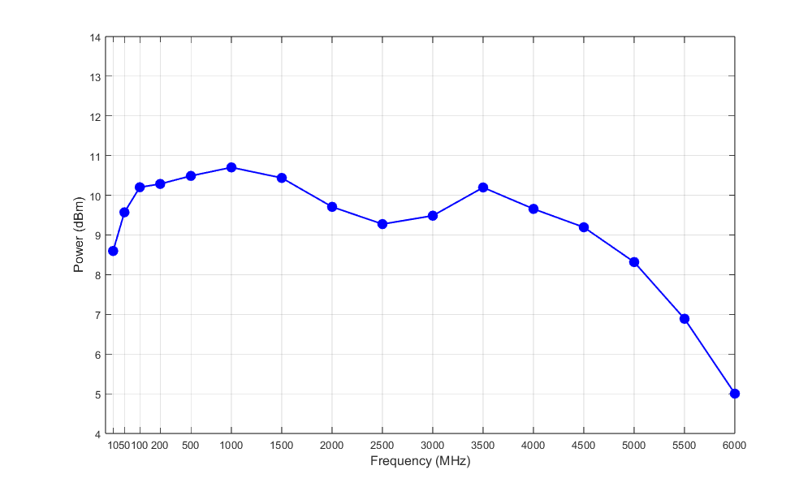

*Figure 7. TX output P1dB.*

### Receive Input Power and Gain

YunSDR lists programmable RX gain from 0 to 58 dB in 1 dB steps, with minimum gain at startup. The value represents a relative gain setting implemented through the RFSoC's internal DSA and the onboard external DSA. The following values are approximate readings from the published plot at RX gain = 27 dB.

| Frequency | RX input P1dB (dBm) | Minimum detectable signal (dBm) |
| --- | ---: | ---: |
| 500 MHz | Approx. −21 | Approx. −99 |
| 1 GHz | Approx. −19 | Approx. −101 |
| 2 GHz | Approx. −17 | Approx. −89 |
| 3.5 GHz | Approx. −13 | Approx. −99 |
| 5 GHz | Approx. −9 | Approx. −89 |
| 5.8 GHz | Approx. −3 | Approx. −88 |

The published minimum detectable signal values retain the original plot's measurement basis. The equivalent noise bandwidth and detection criterion are unspecified in the plot. Record the RX input damage level, the input power at the board connector that drives the ADC to 0 dBFS, and the input P1dB separately. [YunSDR product specifications](https://www.yunsdr.com/resource-center/IQX8400/specification)

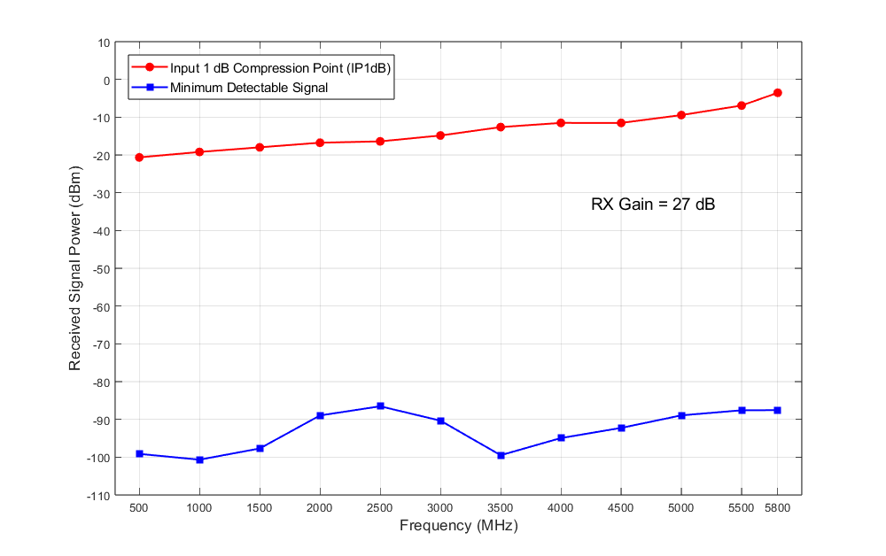

*Figure 8. RX input P1dB and minimum detectable signal.*

### Phase Noise and Transmit EVM

| Carrier frequency | 100 Hz offset | 1 kHz offset | 10 kHz offset | 100 kHz offset | 1 MHz offset |
| --- | ---: | ---: | ---: | ---: | ---: |
| 1 GHz | −90 | −111 | −115 | −117 | −128 |
| 2.5 GHz | −83 | −104 | −110 | −113 | −120 |
| 4 GHz | −78 | −97 | −108 | −111 | −117 |
| 6 GHz | −74 | −92 | −105 | −108 | −114 |

Phase noise is in dBc/Hz. Values are approximate readings from YunSDR's system phase-noise plot. The reference source, PLL configuration, sample rate, and temperature affect the results. [YunSDR product specifications](https://www.yunsdr.com/resource-center/IQX8400/specification)

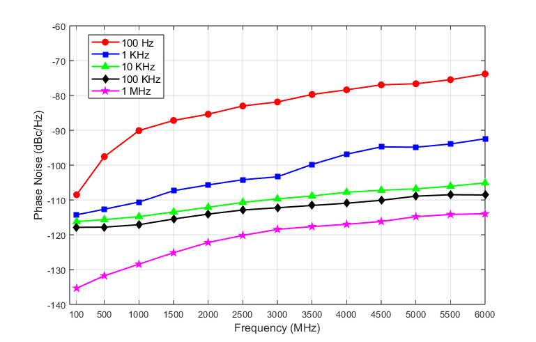

*Figure 9. System phase noise. The legend shows the offset from the carrier.*

For a **100 MHz TX signal**, the published EVM plot shows approximately **0.53%, 0.56%, 0.94%, 1.33%, and 1.41%** at carrier frequencies of 500 MHz, 1 GHz, 3 GHz, 6 GHz, and 7.1 GHz, respectively. The plot leaves the modulation format, output power, and EVM statistic unspecified. Define the waveform, reference power, and equalizer settings for acceptance testing. [YunSDR product specifications](https://www.yunsdr.com/resource-center/IQX8400/specification)

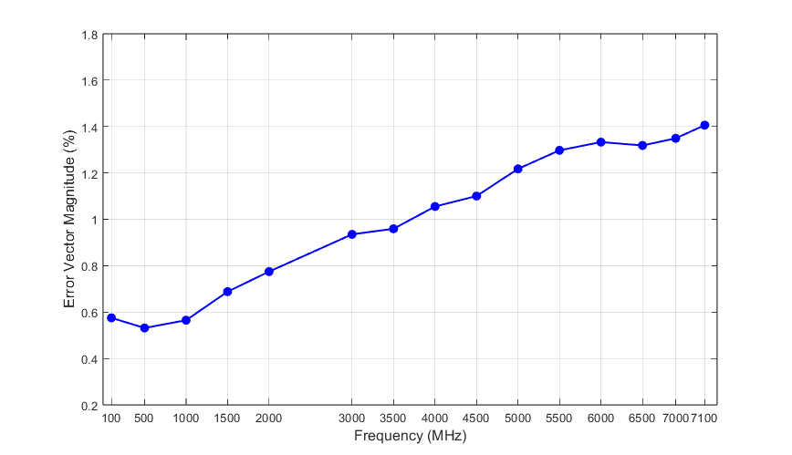

*Figure 10. Transmit EVM for a 100 MHz signal.*

## 7 RF Signal-Chain Estimates and Test Methods

### Receiver Noise Figure Budget

This estimate covers the Rev1.1 small-signal noise figure (NF) from the RF connector to the digital I/Q output. It uses typical LNA gain and NF at 25 °C, with 1 dB of loss ahead of the LNA and 3 dB between the LNA and ADC. The latter includes the limiter, DSA insertion loss at the zero setting, balun, and PCB traces. Both DSAs are set to zero programmed attenuation. The AMD datasheet gives a typical small-signal ADC noise density of −154 dBFS/Hz and a full-scale input of approximately +1 dBm. This corresponds to approximately −153 dBm/Hz referred to the ADC input and an equivalent ADC NF of about 21 dB relative to −174 dBm/Hz at 290 K.

| Frequency (GHz) | LNA gain (dB) | LNA NF (dB) | Estimated board input-referred NF (dB) |
| ---: | ---: | ---: | ---: |
| 0.5 | 22.86 | 2.34 | 5.8 |
| 2.0 | 19.89 | 2.32 | 7.3 |
| 3.0 | 18.16 | 2.43 | 8.5 |
| 4.0 | 16.91 | 2.70 | 9.4 |
| 6.0 | 16.19 | 2.87 | 10.0 |

Using linear power ratios, the cascaded noise factor is **Fsystem = Lpre × [FLNA + (Lpost × FADC − 1) / GLNA]**. Convert the result to decibels for the input-referred noise calculation. At 2 GHz, for example, 7.3 dB NF over a 1 MHz equivalent noise bandwidth yields approximately −106.7 dBm of input-referred noise. Receiver sensitivity for a particular waveform also depends on the signal-to-noise ratio (SNR) required for demodulation and the implementation margin. [AMD DS926 RF-ADC performance, Table 9](https://docs.amd.com/r/en-US/ds926-zynq-ultrascale-plus-rfsoc/RF-ADC-Performance-Characteristics)

### Transmit Noise Spectral Density Budget

The budget uses discrete AMD datasheet points for the 20 mA low-noise DAC mode with an external sample clock and a 0 dBFS continuous-wave (CW) tone. At the zero attenuation setting, the DSA contributes 1.6 to 2.0 dB of typical insertion loss. The balun and upstream interconnect account for a further 1 dB, and the path from the PA output to the connector accounts for 0.8 dB. The calculation uses typical PA gain and NF at 9 V and sums the DAC, passive network, and amplifier noise contributions in linear power units.

| Frequency (GHz) | DAC noise spectral density (dBm/Hz) | Estimated noise spectral density at the connector (dBm/Hz) |
| ---: | ---: | ---: |
| 0.24 | −164.4 | −149.9 |
| 1.9 | −160.4 | −146.7 |
| 2.4 | −159.9 | −146.4 |
| 3.5 | −158.8 | −145.2 |
| 4.9 | −157.3 | −144.0 |
| 5.9 | −157.0 | −143.8 |

These points indicate the noise level of a small-signal linear chain at zero programmed attenuation. For measurements, record the operating level, carrier offset, resolution bandwidth normalization, and treatment of discrete spurs. [AMD DS926 RF-DAC performance, Table 6](https://docs.amd.com/r/en-US/ds926-zynq-ultrascale-plus-rfsoc/RF-DAC-Performance-Characteristics)

### Linearity, Isolation, and Synchronization

Unless a different carrier frequency is listed, the budget assumes **2 GHz, 50 Ω, and zero programmed attenuation on both the internal and external DSAs**. Results identify the reference plane and scope of the model.

| Parameter | Result | Test method |
| --- | --- | --- |
| NCO tuning resolution | Approximately **18 µHz** for the ADC and **35 µHz** for the DAC. These are the theoretical 48-bit NCO step sizes at sample rates of 5.00 and 9.85 GS/s, respectively. | Step the frequency setting and compare the commanded frequency with the measured carrier. |
| TX/RX hot-switch settling time | **225 ns** typical for the RF switch at 1 GHz, to within ±0.1 dB of final insertion loss. | Capture the trigger edge, RF envelope, and RX I/Q simultaneously. Measure the recovery time for TX-to-RX and RX-to-TX transitions. |
| External TX/RX attenuation settling time | **0.5 µs** typical after the DSA latch, to within ±0.05 dB of the final level. **Approximately 2.1 µs** including a 16-bit write at 10 MHz, followed by settling. | Change the attenuation setting. Use an oscilloscope to measure the interval from the serial write or latch event to RF level settling. |
| Converter spurious-free dynamic range (SFDR) | DAC **73.6 dBc** at 2.4 GHz in 20 mA low-noise mode, with the internal PLL and a 0 dBFS tone. ADC **82 dBc** at 3.5 GHz with zero DSA attenuation. Both are typical converter figures with the harmonics or spurs specified in the datasheet excluded. | Apply or generate a single tone, capture the spectrum, and find the largest spur. Identify harmonics, images, and interleaving spurs separately. |
| ADC two-tone third-order intermodulation (IM3) | **−75 dBc**, typical for the converter at a 2.4 GHz center frequency, with each tone at −7 dBFS, 20 MHz spacing, and zero DSA attenuation. | Apply two tones and measure the third-order intermodulation products relative to the fundamental tones. |
| TX OIP3 and RX IIP3 | TX **+34.7 dBm**, the output third-order intercept of the final analog stage referred to the TX port. RX **+6.1 dBm**, the input third-order intercept for the switch, amplifier, and ADC cascade referred to the RX port. | Measure third-order intermodulation at the port with a two-tone stimulus and extrapolate IP3. |
| TX adjacent-channel leakage ratio (ACLR) | **78.4 dB**, based on the typical 20 mA low-noise DAC result at 2.4 GHz for 3.84 MHz QPSK, 7.6 dB PAPR, and an external sample clock, assuming a linear output path. For 0 dBm TX main-channel power and a 3.84 MHz adjacent-channel integration bandwidth, connector noise alone corresponds to **80.6 dB** ACLR. | Transmit a modulated waveform and integrate the power in the main and adjacent channels. |
| RX full-scale input and overload | **−14.9 dBm** from a linear extrapolation to digital full scale at 2 GHz. The estimate can deviate near compression. **Approximately +14 dBm** is the front-end overload bound referred from the LNA's absolute maximum input rating. Determine the permissible board input and damage threshold through board-level overload tests. | Sweep from a low level to digital full scale. Use a dedicated test sample to characterize the board damage threshold. |
| RX EVM | **Approximately 0.15% RMS** from the noise contribution alone at −30 dBm input, 100 MHz equivalent noise bandwidth, and 7.3 dB NF. | Apply a known modulation waveform, sweep the input level, and measure RMS EVM. |
| Passband amplitude flatness | In a simplified chain model over **1.8 to 2.2 GHz**, approximately **0.10 dB peak-to-peak** for TX and **0.84 dB peak-to-peak** for RX. | Sweep the frequency, normalize the amplitude response, and take the difference between the maximum and minimum levels within the passband. |
| Passband phase flatness and group delay | Nominal propagation delay in the simplified chain model is approximately **0.298 ns**. After removing the linear phase, estimated mismatch-induced phase ripple is TX **±0.13°** and RX **±0.23°**. Estimated group delay deviation is TX **±1.3 ps** and RX **±2.4 ps**. | Sweep the complex response and derive group delay from the phase slope. Remove the fitted linear phase to obtain residual phase ripple. |
| Port return loss | Approximately **19.8 dB** for TX and **17.9 dB** for RX at 2 GHz, assuming the two reflected waves in the matching model add in phase. | Calibrate a vector network analyzer (VNA) at the RF connector reference plane and measure the port reflection coefficient. |
| TX-to-TX, RX-to-RX, and TX-to-RX isolation | At 2 GHz, with an assumed 65 dB PCB coupling path and the leakage components added in phase, approximately **62.6 dB** for both TX-to-TX and RX-to-RX, and **59.9 dB** for TX-to-RX in the TDD shared-port switch leakage model. | Apply a single tone to the stimulus port. Measure leakage at the affected port for each port pair. |
| Channel-to-channel amplitude and phase matching and repeatability | At a 10 dB external DSA setting, the attenuation errors of two paths can differ by up to **2.45 dB** from the DSAs alone. A 1 mm trace-length difference corresponds to **4.3°** of phase skew. A residual timing skew of 5 ps after reset corresponds to **3.6°**. | Drive the channels from a common source and compare their amplitude and phase. Repeat after retuning or restarting. |

**Calculation Basis**

- **IP3, full-scale input, and overload.** The TX budget starts from a typical PA OIP3 of 35.47 dBm and subtracts approximately 0.8 dB of downstream loss. The RX budget uses an LNA gain of 19.89 dB, a typical LNA OIP3 of 25.50 dBm, and 1 dB and 3 dB of loss before and after the LNA, respectively. The ADC model uses the −75 dBc two-tone IM3 figure at 1.9 GHz as an approximation. The RX calculation refers the input intercepts of all modeled stages to the RX connector and sums their reciprocals in linear power units. The small-signal RX gain is 15.89 dB, so approximately +1 dBm of ADC full-scale input corresponds to −14.9 dBm at the RX connector. Adding approximately 1 dB of upstream loss to the LNA absolute maximum input rating of +13 dBm gives the front-end overload bound.
- **ACLR and EVM.** The 2.4 GHz TX noise estimate of −146.4 dBm/Hz gives −80.6 dBm after integration over 3.84 MHz. The typical DAC ACLR is listed separately. For RX, −174 dBm/Hz thermal noise density, 7.3 dB NF, and 100 MHz bandwidth yield −86.7 dBm of input-referred noise. At −30 dBm input, this gives 56.7 dB SNR. The listed RX EVM accounts for this noise contribution alone. [AMD DS926 RF-DAC performance](https://docs.amd.com/r/en-US/ds926-zynq-ultrascale-plus-rfsoc/RF-DAC-Performance-Characteristics) · [AMD DS926 RF-ADC performance](https://docs.amd.com/r/en-US/ds926-zynq-ultrascale-plus-rfsoc/RF-ADC-Performance-Characteristics)
- **Amplitude, phase, and impedance.** The model uses a 50 mm equivalent trace, an effective relative permittivity of 3.2, typical amplifier frequency response, and two reflection planes. It uses return losses of 23 dB at the RF switch and either 30.06 dB at the PA output or 25.06 dB at the LNA input. The passband amplitude budget adds the maximum ripple from the end reflections to the amplifier gain variation from 1.8 to 2.2 GHz. The port return loss assumes in-phase addition of the two reflected waves. The group delay estimate combines trace propagation and the change in phase slope from round-trip reflections. Board-level swept measurements account for the converters, baluns, other PCB transitions, and digital filters.
- **Isolation and channel matching.** The like-channel model uses the 75 dB ZU4xDR-family crosstalk isolation reference from DS926, characterized on the XCZU46DR-H1760. The shared-port TDD model uses 67 dB of isolation at 2 GHz from the common RF switch port (RFC) to the off-state branch. Both estimates include an assumed 65 dB PCB coupling path. The external DSA attenuation error at the 10 dB setting ranges from −1.00 to +1.45 dB. The phase offsets use 360° × carrier frequency × timing skew, evaluated at 2 GHz. [AMD DS926 RF-ADC electrical characteristics](https://docs.amd.com/r/en-US/ds926-zynq-ultrascale-plus-rfsoc/RF-ADC-Electrical-Characteristics) · [AMD DS926 RF-DAC electrical characteristics](https://docs.amd.com/r/en-US/ds926-zynq-ultrascale-plus-rfsoc/RF-DAC-Electrical-Characteristics)

## 8 Package Contents

| No. | Item | Specification or part number | Quantity |
| ---: | --- | --- | ---: |
| 1 | Software-defined radio board | IQX8400 | 1 |
| 2 | Omnidirectional 5G test antenna | ANT-1427-5925MHZ | 8 |
| 3 | Straight-through SMA cable | SMA to SMA | 4 |
| 4 | PCIe cooling fan assembly | PCIE-FAN | 1 |

Package contents depend on the order configuration. Use the supplied antennas within their rated frequency range. The host, GPS antenna, additional attenuators, and project-specific heatsink enclosure are available as options according to the project configuration. [YunSDR list of supplied accessories](https://www.yunsdr.com/resource-center/IQX8400/specification)

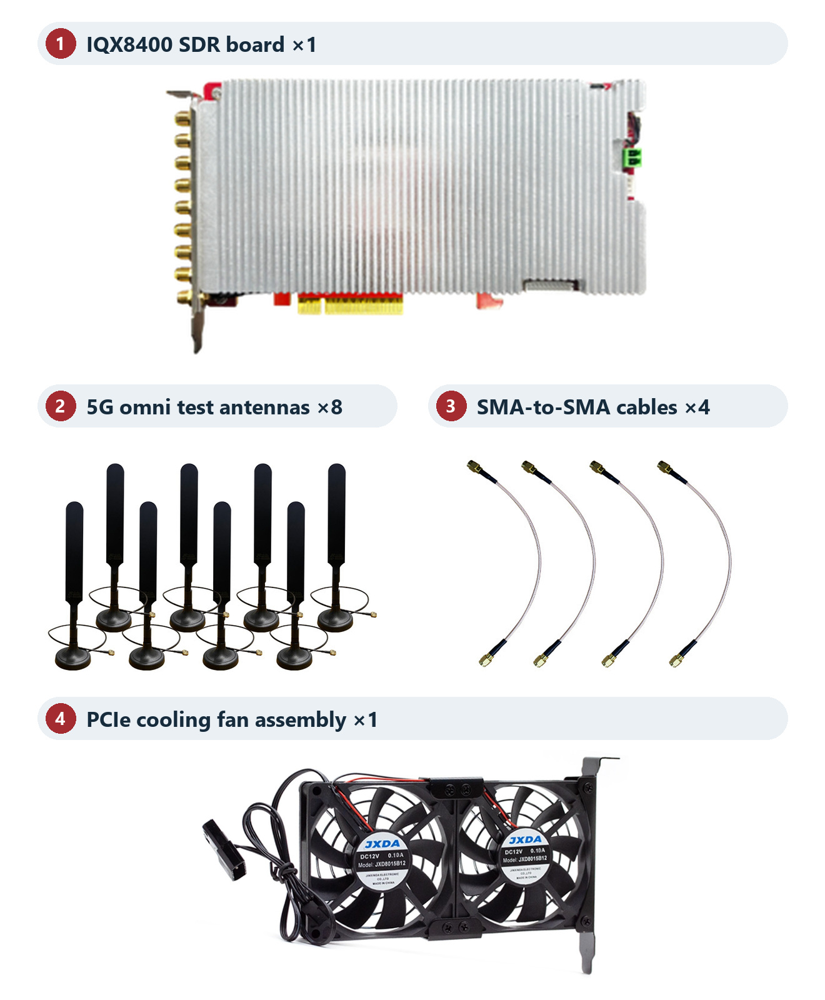

*Figure 11. IQX8400 board with heatsink and supplied accessories.*
